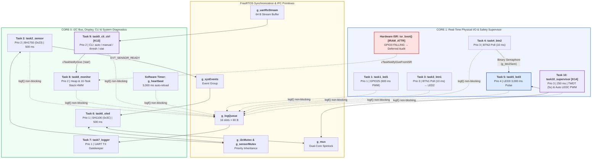
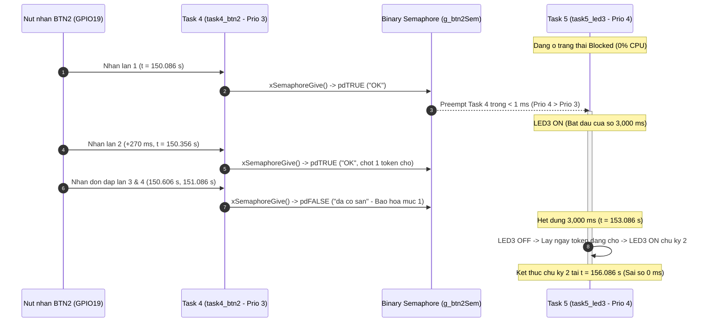
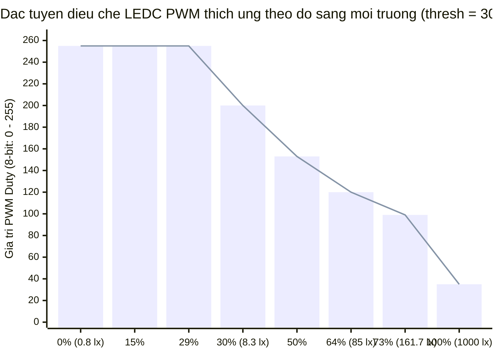

# Project Cá Nhân (70%) – Hệ Thống Nhúng Đa Nhiệm Thời Gian Thực FreeRTOS trên ESP32

- **Sinh viên thực hiện:** Lê Công Quốc Anh — **MSSV:** `24119009`
- **Môn học:** Real-Time Operating Systems (Hệ điều hành thời gian thực)
- **Học kỳ:** Học kỳ 1 — Năm học 2026–2027
- **Giảng viên hướng dẫn:** ThS. Huỳnh Hoàng Hà
- **Đơn vị:** Khoa Điện – Điện tử, Trường Đại học Sư phạm Kỹ thuật TP.HCM (HCMUTE)
- **Báo cáo chi tiết:** [`Report_RTOS_ESP32_Project70_v10.pdf`](./Report_RTOS_ESP32_Project70_v10.pdf)
- **Video chạy thực tế trên phần cứng:** [https://www.youtube.com/watch?v=JD2I9vr1ZA4]

---

## 1. Tổng quan dự án

Dự án thiết kế, xây dựng và kiểm chứng thực nghiệm một nút điều khiển, thu thập dữ liệu đo lường và giám sát an toàn thời gian thực đa nhiệm trên vi điều khiển lõi kép **ESP32-WROOM-32** chạy nhân **SMP FreeRTOS**. Hệ thống gồm **10 Task người dùng** và **1 Software Timer** được phân tải bất đối xứng trên hai nhân CPU (`Core 0` và `Core 1`), tích hợp **14 cơ chế cốt lõi của FreeRTOS & ESP-IDF** (`[K1]`–`[K14]`) nhằm loại bỏ hoàn toàn hiện tượng trôi pha thời gian (cumulative phase drift), xung đột bus I²C dùng chung, chồng chéo ký tự UART và treo hệ thống.

### Kết quả thực nghiệm trên phần cứng thật (> 820 giây bản 10-task & > 1,111 giây bản 8-task)

| Hạng mục kiểm thử | Kết quả đo thực tế (Serial Monitor & OLED SH1106) |
|---|---|
| **Chu kỳ nháy LED1 & LEDC PWM (Task 1 & 10)** | Chu kỳ `600 ms` (đảo mỗi `300 ms` qua `vTaskDelayUntil`), độ lệch pha tích lũy **0 ms**; độ sáng PWM 5 kHz tự động điều chế từ **duty 99** (`161.7 lx`) đến **duty 255** (`0.8 lx`) |
| **Cảm biến ánh sáng BH1750 (Task 2)** | Trong phòng: **97.5 – 113.3 lx** (`66% – 68%`); che tay: giảm mượt xuống **50.8 lx** (`56%`) và tối hẳn **0.8 lx** (`0%`); tự phục hồi hot-plug sau lỗi I²C NACK trong **1.5 s** |
| **Phản hồi nút nhấn BTN1 (Task 3)** | Lọc chống dội phần mềm `30 ms` (`INPUT_PULLUP`), đảo trạng thái LED2 tức thì, **0 lỗi nhiễu tiếp điểm** |
| **Đồng bộ Binary Semaphore BTN2 → LED3** | Độ trễ chiếm quyền (preemption) **`< 1 ms`** (`Priority = 4`); LED3 sáng chuẩn xác **3,000 ms** (`150.086 s → 153.086 s`); bấm dồn báo `da co san` (bão hòa mức 1) |
| **Màn hình OLED SH1106 1.3" (Task 6)** | Làm tươi `500 ms/lần`, đồng bộ khởi động bằng `Event Group`, hiển thị chế độ `[AUTO/MAN]`, `lux`, `%`, đếm ngược `3.0s`, `seq` và `PWM` không xung đột I²C |
| **Gatekeeper Queue & Heartbeat (Task 7)** | Hàng đợi 16 phần tử (`g_logQueue`) xuất UART 115200 baud độc quyền, chu kỳ heartbeat **5,000 ms**, số gói tin bị rơi **`drop = 0`** |
| **CLI hai chiều qua Stream Buffer (Task 9)** | Bộ đệm vòng không khóa `64 bytes` (`g_uartRxStream`), xử lý mượt 4 lệnh `auto`, `manual`, `thresh=<0..100>`, `stat` mà không làm nghẽn luồng log |
| **Hardware Watchdog & Tài nguyên (Task 8 & 10)** | **0 lần reset Watchdog** (TWDT timeout `5 s`, nạp mỗi `250 ms`); **16 task hoạt động** (`10 user + 6 system`); SRAM Heap trống ổn định **307,240 B**; Stack trống tối thiểu mỗi task **≥ 1,236 B** (mức dùng `< 60%`) |

---

## 2. Sơ đồ kết nối phần cứng (ESP32-WROOM-32 DevKitC 38 chân)

Mạch sử dụng bo mạch mở rộng Domino (Screw-Terminal Shield) gắn trên đế mica kết nối với ngoại vi qua bus I²C 100 kHz và các chân GPIO:

| Linh kiện | Chân ESP32 (`config.h`) | Chế độ / Giao tiếp | Chức năng trong hệ thống |
|---|---|---|---|
| **LED1** (+ điện trở 220 Ω – 1 kΩ) | `GPIO25` | LEDC PWM Ch.0 (`5 kHz`, 8-bit) | Nháy định kỳ chu kỳ `600 ms` (Task 1) kết hợp điều chế độ sáng thích ứng (Task 10) |
| **LED2** (+ điện trở 220 Ω – 1 kΩ) | `GPIO26` | Digital Output | Đảo trạng thái ON/OFF mỗi lần nhấn BTN1 (Task 3) |
| **LED3** (+ điện trở 220 Ω – 1 kΩ) | `GPIO27` | Digital Output | Sáng đúng `3,000 ms` khi nhận Binary Semaphore từ BTN2 (Task 5) |
| **Nút nhấn BTN1** (xanh) | `GPIO18` | `INPUT_PULLUP` (nối GND) | Điều khiển bật/tắt LED2, chống dội phần mềm `30 ms` (Task 3) |
| **Nút nhấn BTN2** (trắng) | `GPIO19` | `INPUT_PULLUP` (nối GND) | Cấp token vào `g_btn2Sem` đánh thức Task 5 (Task 4) |
| **Nút BOOT** (có sẵn trên kit) | `GPIO0` | `INPUT_PULLUP` + Ngắt ngoài (`FALLING`) | Kích hoạt ISR trong IRAM đánh thức Task 8 in thống kê Heap & Stack HWM |
| **Cảm biến ánh sáng BH1750** | `SDA = GPIO21`, `SCL = GPIO22` | I²C (`0x23`, chân `ADO` nối `GND`) | Đo độ rọi (lux) và quy đổi logarit ra `%` mỗi `500 ms` (Task 2) |
| **Màn hình OLED SH1106 1.3"** | `SDA = GPIO21`, `SCL = GPIO22` | I²C (`0x3C`, `128x64`) | Hiển thị `[AUTO/MAN]`, LED1/2/3, lux, `%`, đếm ngược 3.0s, `seq` và `PWM` (Task 6) |

*(Ghi chú: Các chân mở rộng `PIN_TEMP = GPIO35` và kênh RGB `GPIO16/17/5` đã được khai báo sẵn trong `include/config.h` cho giai đoạn phát triển tiếp theo).*

---

## 3. Kiến trúc phần mềm 10-Task & Phân bổ trên 2 nhân

### 3.1 Sơ đồ phân tải lõi kép và giao tiếp liên tiến trình (IPC)



### 3.2 Bảng thông số lập lịch & tài nguyên của 10 Task

| Task | Tên hàm | Nhân CPU | Priority | Stack | Chu kỳ / Sự kiện | Cơ chế FreeRTOS & ESP-IDF áp dụng |
|---|---|---|---|---|---|---|
| **Task 1** | `task1_led1` | Core 1 | 1 | 2,048 B | Chu kỳ `600 ms` (đảo mỗi `300 ms`) | `vTaskDelayUntil()` (`[K2]`), xuất xung qua LEDC PWM Ch.0 |
| **Task 2** | `task2_sensor` | Core 0 | 2 | 3,072 B | Chu kỳ `500 ms` | `g_i2cMutex`, `g_sensorMutex` (`[K5]`), `xEventGroupSetBits` (`[K7]`), tự phục hồi NACK |
| **Task 3** | `task3_btn1` | Core 1 | 3 | 3,072 B | Quét mỗi `10 ms` | Chống dội phím `30 ms`, `vTaskDelay()` (`[K3]`) |
| **Task 4** | `task4_btn2` | Core 1 | 3 | 3,072 B | Quét mỗi `10 ms` | `xSemaphoreGive(g_btn2Sem)` (`[K4]`), `portENTER_CRITICAL` (`[K9]`) |
| **Task 5** | `task5_led3` | Core 1 | **4** | 3,072 B | Chờ sự kiện (`portMAX_DELAY`) | `xSemaphoreTake(g_btn2Sem)` (`[K4]`), ưu tiên cao nhất phản hồi `< 1 ms` |
| **Task 6** | `task6_oled` | Core 0 | 1 | 4,096 B | Chu kỳ `500 ms` | `xEventGroupWaitBits` (`[K7]`), `g_i2cMutex`, `g_sensorMutex` (`[K5]`), Spinlock (`[K9]`) |
| **Task 7** | `task7_logger` | Core 0 | 1 | 3,072 B | Chờ hàng đợi (`portMAX_DELAY`) | Mẫu thiết kế **Gatekeeper** độc quyền xuất UART TX qua `g_logQueue` (`[K6]`) |
| **Task 8** | `task8_monitor` | Core 0 | 2 | 4,096 B | Chờ thông báo từ ISR / CLI | **Deferred ISR** (`vTaskNotifyGiveFromISR`, `[K8]`), `uxTaskGetStackHighWaterMark()` (`[K11]`) |
| **Task 9** | `task9_cli_ctrl` | Core 0 | 2 | 4,096 B | Timeout `20 ms` trên Stream Buffer | `xStreamBufferCreate(64, 1)` (`[K13]`) nhận và phân tích lệnh UART RX hai chiều |
| **Task 10** | `task10_supervisor` | Core 1 | 3 | 3,072 B | Chu kỳ `250 ms` | **Hardware TWDT 5 s** (`esp_task_wdt_reset`) & **LEDC PWM** thích ứng (`[K14]`) |
| **Timer** | `heartbeat_cb` | Timer Svc | – | – | Auto-reload `5,000 ms` | `xTimerCreate()` (`[K10]`) báo `uptime`, `btn2Count`, `drop` |
| **Setup** | `loop()` | – | – | – | Chạy 1 lần lúc khởi động | `vTaskDelete(NULL)` (`[K12]`) giải phóng ~8 KB SRAM của `loopTask` |

---

## 4. 14 Cơ chế FreeRTOS & ESP-IDF áp dụng (`[K1]`–`[K14]`)

| Ký hiệu | Cơ chế RTOS / ESP-IDF | API / Đối tượng nhân | Vai trò kỹ thuật trong hệ thống |
|---|---|---|---|
| `[K1]` | **SMP Task Creation & Core Affinity** | `xTaskCreatePinnedToCore()` | Ghim cố định 10 Task lên Core 0 và Core 1 với phân cấp ưu tiên 1–4 |
| `[K2]` | **Drift-Free Periodic Timing** | `vTaskDelayUntil()` | Đảm bảo chu kỳ tuyệt đối `600 ms` (LED1), `500 ms` (Sensor/OLED), `250 ms` (Supervisor) |
| `[K3]` | **Cooperative Yield Delay** | `vTaskDelay()` | Nhường CPU ở trạng thái Blocked khi quét phím `10 ms` và giữ sáng LED3 `3,000 ms` |
| `[K4]` | **Event Synchronization** | `xSemaphoreCreateBinary()` | `g_btn2Sem` đồng bộ sự kiện từ Task 4 sang Task 5 với cơ chế bão hòa mức 1 |
| `[K5]` | **Mutex & Priority Inheritance** | `xSemaphoreCreateMutex()` | `g_i2cMutex` chống xung đột bus I²C và chống đảo ngược ưu tiên; `g_sensorMutex` bảo vệ dữ liệu đo |
| `[K6]` | **Queue & Gatekeeper Pattern** | `xQueueCreate(16, ...)` | `logf()` đẩy bản tin không khóa; duy nhất Task 7 xuất ra cổng Serial |
| `[K7]` | **Startup Event Synchronization** | `xEventGroupCreate()` | Task 6 chờ cờ `EVT_SENSOR_READY` từ Task 2 trước khi vẽ khung hình đầu tiên |
| `[K8]` | **Deferred ISR & Task Notification** | `vTaskNotifyGiveFromISR()` | Ngắt nút BOOT (`IRAM_ATTR`) gửi thông báo siêu nhẹ (~1 µs) đánh thức Task 8 |
| `[K9]` | **Dual-Core Critical Section** | `portENTER_CRITICAL(&g_mux)` | Khóa Spinlock phần cứng bảo vệ các biến chia sẻ giữa 2 nhân (`g_led3OffTick`, `g_btn2Count`, `g_logDropped`) |
| `[K10]` | **Auto-Reload Software Timer** | `xTimerCreate("hb", 5000ms)` | Callback định kỳ mỗi `5 s` báo nhịp tim hệ thống và kiểm tra số log bị rơi |
| `[K11]` | **Stack Watermark Auditing** | `uxTaskGetStackHighWaterMark()` | Task 8 đo dung lượng Stack trống tối thiểu của toàn bộ 10 Task khi nhận ngắt BOOT hoặc lệnh `stat` |
| `[K12]` | **Idle Loop Task Deletion** | `vTaskDelete(NULL)` | Xóa `loopTask` mặc định của Arduino sau `setup()`, tiết kiệm ~8 KB SRAM |
| `[K13]` | **Stream Buffer UART RX CLI** | `xStreamBufferCreate(64, 1)` | Bộ đệm vòng khóa-không-cần-mutex nhận từng byte UART RX cho Task 9 phân tích lệnh |
| `[K14]` | **Hardware Watchdog & LEDC PWM** | `esp_task_wdt_reset()` / `ledcWrite()` | Task 10 giám sát treo hệ thống (TWDT 5 s) và điều chế PWM phần cứng 5 kHz theo ánh sáng |

---

## 5. Phân tích & Biểu đồ kết quả thực nghiệm

### 5.1 Chiếm quyền ưu tiên & bão hòa Binary Semaphore (Task 4 → Task 5)

Khi nhấn nút BTN2 dồn dập (burst presses) trong khoảng `150.086 s – 156.086 s`, Binary Semaphore (`g_btn2Sem`, dung lượng tối đa = 1 token) tự động chốt 1 chu kỳ kế tiếp và từ chối các xung dội thừa (`pdFALSE` → `da co san`), đảm bảo mỗi xung LED3 kéo dài chuẩn xác **3,000 ms** với độ trễ chiếm quyền `< 1 ms`:



### 5.2 Đường đặc tuyến điều chế độ sáng LEDC PWM thích ứng (Task 10)

Độ rọi môi trường $lux$ từ BH1750 được quy đổi sang thang phần trăm logarit $Light(\%) = \min\left(100, \frac{\log_{10}(lux)}{\log_{10}(1000)} \times 100\right)$, sau đó Task 10 tính toán độ rộng xung PWM 8-bit (`0–255`) nghịch biến với ánh sáng môi trường (ngưỡng mặc định $T_{thresh} = 30\%$):

$$\text{Duty}_{\text{PWM}} = \begin{cases} 255, & \text{nếu } \text{Light}(\%) < T_{\text{thresh}} \\ 200 - 165 \times \dfrac{\text{Light}(\%) - T_{\text{thresh}}}{100 - T_{\text{thresh}}}, & \text{nếu } \text{Light}(\%) \ge T_{\text{thresh}} \end{cases}$$



### 5.3 Kiểm toán dung lượng Stack thực tế của toàn bộ 10 Task (Task 8 Monitor)

Kết quả chụp tại thời điểm $t = 715.14\text{ s}$ thông qua lệnh `stat` từ UART CLI (tổng cộng **16 Task** đang chạy, **307,240 bytes** SRAM Heap trống, toàn bộ 10 Task người dùng đều có mức sử dụng Stack **< 60%**):

```mermaid
xychart-beta
    title "So sanh Stack cap phat vs Muc dinh su dung thuc te cua 10 Task (Bytes)"
    x-axis ["led1", "sensor", "btn1", "btn2", "led3", "oled", "logger", "monitor", "cli_ctrl", "superv"]
    y-axis "Dung luong Stack (Bytes)" 0 --> 4200
    bar [2048, 3072, 3072, 3072, 3072, 4096, 3072, 4096, 4096, 3072]
    bar [500, 1836, 532, 524, 512, 1852, 1716, 1356, 1388, 512]
```



| Tên Task | Nhân / Prio | Stack cấp phát | Stack trống tối thiểu (HWM) | Mức dùng đỉnh | Tỷ lệ sử dụng |
|---|---|---:|---:|---:|---:|
| `led1` (Task 1) | Core 1 / P1 | 2,048 B | 1,548 B | 500 B | `24.4%` |
| `sensor` (Task 2) | Core 0 / P2 | 3,072 B | **1,236 B** | **1,836 B** | **`59.8%`** |
| `btn1` (Task 3) | Core 1 / P3 | 3,072 B | 2,540 B | 532 B | `17.3%` |
| `btn2` (Task 4) | Core 1 / P3 | 3,072 B | 2,548 B | 524 B | `17.1%` |
| `led3` (Task 5) | Core 1 / P4 | 3,072 B | 2,560 B | 512 B | `16.7%` |
| `oled` (Task 6) | Core 0 / P1 | 4,096 B | 2,244 B | 1,852 B | `45.2%` |
| `logger` (Task 7) | Core 0 / P1 | 3,072 B | 1,356 B | 1,716 B | `55.9%` |
| `monitor` (Task 8) | Core 0 / P2 | 4,096 B | 2,740 B | 1,356 B | `33.1%` |
| `cli_ctrl` (Task 9) | Core 0 / P2 | 4,096 B | 2,708 B | 1,388 B | `33.9%` |
| `supervisor` (Task 10) | Core 1 / P3 | 3,072 B | 2,560 B | 512 B | `16.7%` |

---

## 6. Giao diện dòng lệnh tương tác hai chiều (UART CLI – Task 9)

Mở Serial Monitor ở tốc độ **115200 baud** (kết thúc dòng `\n` hoặc `\r\n`) để gửi các lệnh điều khiển thời gian thực qua **Stream Buffer 64 bytes**:

| Lệnh CLI | Chức năng thực thi | Phản hồi từ Gatekeeper Logger (Task 7) |
|---|---|---|
| `auto` | Kích hoạt chế độ điều chế độ sáng PWM thích ứng theo cảm biến BH1750 (`g_autoMode = true`) | `[CLI] Chuyen sang che do AUTO (PWM theo lux)` |
| `manual` | Chuyển sang chế độ thủ công, Task 1 tự điều khiển LED1 nháy vuông góc 0 / 255 (`g_autoMode = false`) | `[CLI] Chuyen sang che do MANUAL` |
| `thresh=<0..100>` | Cập nhật ngưỡng phần trăm ánh sáng kích hoạt tăng cường độ sáng tối đa `PWM = 255` (ví dụ: `thresh=50`) | `[CLI] Cap nhat nguong canh bao = 50%` |
| `stat` | Kích hoạt trực tiếp Task 8 (`xTaskNotifyGive`) để kiểm toán Heap và Stack HWM của 10 Task từ xa | `=== MONITOR: 16 tasks, heap 307240 B ===` |

---

## 7. Cấu trúc thư mục & Hướng dẫn biên dịch (PlatformIO)

```text
├── include/
│   └── config.h                           # Định nghĩa chân GPIO, địa chỉ I2C, chu kỳ, Priority, Stack & PWM
├── src/
│   └── main.cpp                           # Mã nguồn chính triển khai 10 Task, ISR, Software Timer, Stream Buffer & TWDT
├── platformio.ini                         # Cấu hình build PlatformIO (espressif32 @ 6.9.0) & thư viện ngoại vi
├── Report_RTOS_ESP32_Project70_v10.pdf    # Báo cáo tiểu luận hoàn chỉnh (45 trang)
└── README.md                              # Tài liệu tổng quan & hướng dẫn dự án
```

### Thư viện phụ thuộc (`platformio.ini`)
- **Platform:** `espressif32 @ 6.9.0` (Framework Arduino / ESP-IDF SMP FreeRTOS)
- **Thư viện ngoại vi:**
  - `adafruit/Adafruit SH110X @ ^2.1.10`
  - `adafruit/Adafruit GFX Library @ ^1.11.9`
  - `claws/BH1750 @ ^1.3.0`
- **Biên dịch & Nạp firmware:**
  ```bash
  pio run --target upload
  pio device monitor --baud 115200
  ```
